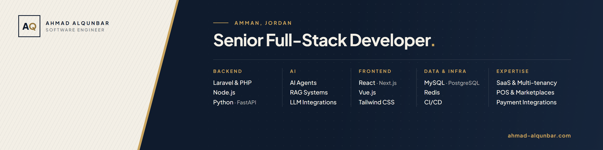

  <a href="https://ahmad-alqunbar.com"><b>Portfolio</b></a> &nbsp;·&nbsp;
  <a href="https://ahmad-alqunbar.com/projects">Case studies</a> &nbsp;·&nbsp;
  <a href="https://ahmad-alqunbar.com/blog">Writing</a> &nbsp;·&nbsp;
  <a href="https://www.linkedin.com/in/ahmad-alqunbar">LinkedIn</a> &nbsp;·&nbsp;
  <a href="mailto:ahmad.alqunbar97@gmail.com">Email</a> &nbsp;·&nbsp;
  <a href="https://wa.me/962788811695">WhatsApp</a>

---

Senior Full-Stack Developer in Amman, Jordan, with 5+ years of building production SaaS platforms, POS and marketplace systems, and payment integrations.

I work across the whole stack: Laravel, Node.js, and Python (FastAPI) on the backend, Vue.js and React on the front end, and the parts in between that have to be right, such as order lifecycles, stock movements, webhook reconciliation, and payment gateways that can't afford to drop a transaction. I also build AI features that reach production: AI agents, RAG pipelines, and LLM integrations.

Currently a Senior Full-Stack Developer at **Ebtikar AI**, working on the Wosul POS & Marketplace platform.

## Selected work

| Project | What it is | My part |
|:--|:--|:--|
| **[Wosul](https://ahmad-alqunbar.com/projects/wosul-cloud-pos-and-marketplace)** | Cloud point-of-sale and marketplace platform for merchants | At Ebtikar AI I work on its core modules: the order lifecycle, stock, payment and loyalty integrations, and the Wosul AI integration. |
| **[NinjaSellers](https://ahmad-alqunbar.com/projects/ninjasellers-platform)** | Marketplace and seller operations platform | Worked on the existing platform, adding modular Laravel and Vue.js services for logistics, payments, and store workflows. |
| **[MedCover](https://ahmad-alqunbar.com/projects/medcover-health-insurance-management-platform)** | Health insurance management for insurers, TPAs, and employers: enrollment, pre-authorizations, claims, settlement, and reporting | Built it from scratch as the senior full-stack developer. |
| **[Banoon](https://ahmad-alqunbar.com/projects/banoon-family-and-child-care-app)** | Mobile app for parents, with a dashboard for admins and healthcare providers: child tracking, bookings, video consultations, courses, and subscriptions | Freelance project. |
| **[Onqoud](https://ahmad-alqunbar.com/projects/onqoud-platform)** | Restaurant analytics connected to the point-of-sale device: sales and customer behavior, with sales forecasting | Freelance project. |

Open source: **[PuckCMS](https://github.com/Ahmad-Alqunbar/puckWithLiferay)**, a bilingual drag-and-drop page builder on Next.js and Puck, with blocks bound to live data from Liferay Headless APIs.

## Stack

| Area | Tools |
|:--|:--|
| **Backend** | Laravel, PHP, Node.js, Python, FastAPI, REST APIs |
| **AI** | AI agents, RAG systems, LLM integrations, OpenAI API |
| **Frontend** | React, Next.js, Vue.js, TypeScript, Tailwind CSS |
| **Data & infra** | MySQL, PostgreSQL, Redis, CI/CD, Linux, Docker |
| **Domains** | SaaS and multi-tenancy, POS and marketplaces, payments (Stripe, HyperPay, Tamara, Bonat) |

## Writing

- [Payments That Never Lose a Transaction: Webhooks, Idempotency, and Reconciliation](https://ahmad-alqunbar.com/blog/payments-that-never-lose-a-transaction-webhooks-idempotency-and-reconciliation)
- [Tenant Isolation: How Multi-Tenant Apps Leak Data, and the Guardrails That Stop It](https://ahmad-alqunbar.com/blog/tenant-isolation-how-multi-tenant-apps-leak-data-and-the-guardrails-that-stop-it)
- [When Your AI Feature Needs Its Own Service: A Laravel and FastAPI Architecture](https://ahmad-alqunbar.com/blog/when-your-ai-feature-needs-its-own-service-a-laravel-and-fastapi-architecture)
- [How to Protect Laravel AI Agents from Prompt Injection](https://ahmad-alqunbar.com/blog/protecting-laravel-ai-agents-from-prompt-injection)
- [The Modular Monolith: Boundaries First, Microservices Later](https://ahmad-alqunbar.com/blog/the-modular-monolith-boundaries-first-microservices-later)

More on **[ahmad-alqunbar.com/blog](https://ahmad-alqunbar.com/blog)**.

## Experience

| Period | Role |
|:--|:--|
| 2025 – present | **Senior Full-Stack Developer**, Ebtikar AI |
| 2024 – 2025 | **Full-Stack Developer**, NinjaSellers |
| 2024 | **Full-Stack Developer**, Onqoud (freelance) |
| 2023 – 2024 | **Full-Stack Developer**, ISRAR Engineering |
| 2022 – 2023 | **Backend Developer**, GerDevs |
| 2021 – 2022 | **Full-Stack Developer Trainee**, Wisdom |

B.Sc. in Computer Science, Isra University. Arabic (native), English (professional).
